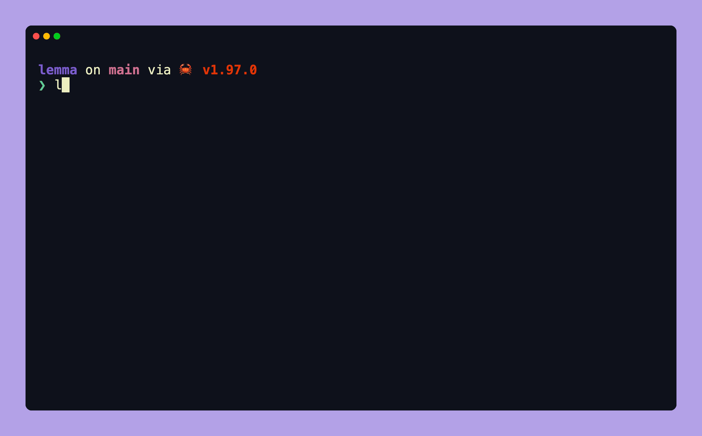
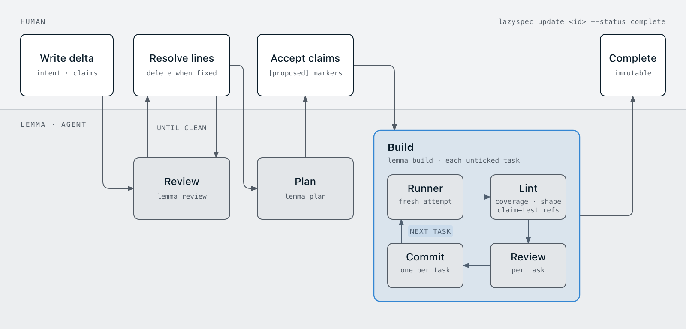

<h1 align="center">
  Λ
  <br>λῆμμα
</h1>



Stepping stones for LLM-assisted development.

> [!NOTE]
> In mathematics and other fields, a **lemma** is a generally minor proven proposition used to prove a larger statement. It is also known as a “helping theorem” or an “auxiliary theorem”. [Source: Wikipedia, “Lemma (mathematics)”](<https://en.wikipedia.org/wiki/Lemma_(mathematics)>).

Lemma is my opinionated approach to using LLMs in software engineering. It prioritises small, verifiable changes over larger orchestration/software factory patterns.

```sh
lemma [command] [options]

# usage
lemma lint [<delta>] [--gate in-progress|complete] [--base <rev>] [--trunk <name>] [--json|--hook]
lemma review <delta> [--dry-run]
lemma plan <delta> [--dry-run]
lemma build <delta> [--task T<n>] [--resume] [--dry-run]
lemma refs <claim>
lemma session-start | lemma signal | lemma stop
```

## Description

Lemma is a tool to help propose & implement changes in small steps that can be checked. You describe what should change and how you will know it works, then use Lemma to review the plan, break it into tasks, and work through those tasks one at a time. It uses lazyspec to link the change, its design, claims and test references connected, and emphasises human decision making.

Lemma has three parts

- A [lazyspec](https://github.com/jkaloger/lazyspec) pack with prompt templates, hooks and the document graph
- A plugin for your LLM harness
- A binary `lemma` that runs linting, reviews, planning and builds; using both LLMs and deterministic functions

Lemma checks change coverage, document shape and the links between claims and tests. It does not run tests or decide whether a test proves a claim. The test runner and CI report test results.

> [!WARNING]
> `lemma` is not a vibe coding tool, and as such requires careful consideration, planning and time to use.
> The result is much more laborious than spec driven/software factory/orchestration/vibe coding patterns, but I think results in better quality engineering outcomes.

## Workflow



A **delta** is the unit of change. You write it: the intent, what is out of scope, the design, and the claims that say how you will know it works. `lemma review` annotates the draft with findings; you resolve them and review again until none remain. `lemma plan` assigns claim ids, proposes missing behaviour and breaks the delta into tasks; you accept or reject each proposal. `lemma build` works through the tasks one at a time: a fresh runner attempts each task, Lemma checks the result and gets a task review, then commits it. When every task is done, you mark the delta complete with `lazyspec update <id> --status complete`.

You run every step. Each command ends with a `next:` line naming the next one.
